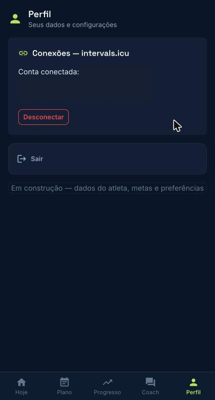

Em **Perfil › Conexões**, toque em **Conectar com intervals.icu** e autorize. Com a conexão:

- seus treinos chegam sozinhos ao Menthoros;
- os treinos aprovados pelo seu treinador vão para o seu calendário do intervals.icu e, dali, para o relógio (veja o passo a passo da sua marca abaixo);
- você vê seus melhores tempos de 400 m a 10 km.

**Desconectar** revoga o acesso a qualquer momento.

## Como o treino chega ao seu relógio

Abaixo do botão de conexão, o app mostra o passo a passo da marca de relógio que você informou no onboarding. As demais marcas ficam recolhidas em **Outro relógio?**. Sem marca informada, o app pede que você a informe no onboarding.

- **Garmin** (**Suportado**): no intervals.icu, abra **Settings › Connections**, conecte o Garmin e marque **Upload planned workouts**. Depois conecte sua conta do intervals.icu ao Menthoros.
- **Apple Watch** (**Compatível via app parceiro**): o intervals.icu não envia treino direto ao Apple Watch. Instale no iPhone o **Intervals.icu Companion** (ou o **Watchletic**, que é pago), ligue o Apple Health, conecte à sua conta do intervals.icu e abra o app para trazer os treinos ao relógio. O envio ao app Treino pode ser manual, e treinos de natação chegam sem estrutura.
- **Outras marcas** (**Ainda não coberto**): o guia ainda não afirma que o treino chega ao relógio. No intervals.icu, procure a sua marca em **Settings › Connections** e avise seu treinador qual relógio você usa.

O Menthoros confirma o envio até o intervals.icu. O último trecho, até o relógio, depende da conexão da sua marca e não é verificado automaticamente.

*Perfil do atleta: conexão com o intervals.icu*
